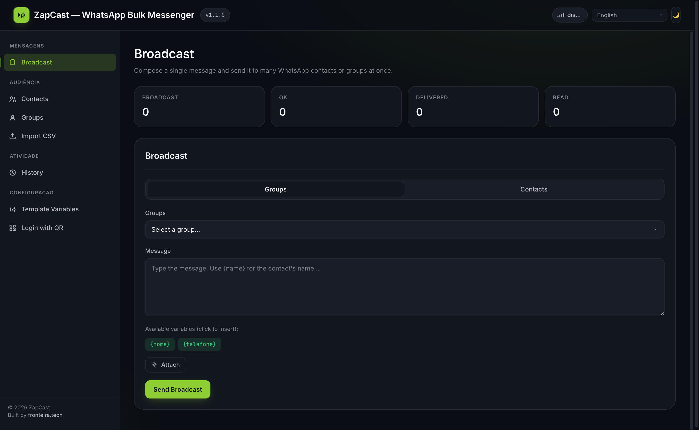
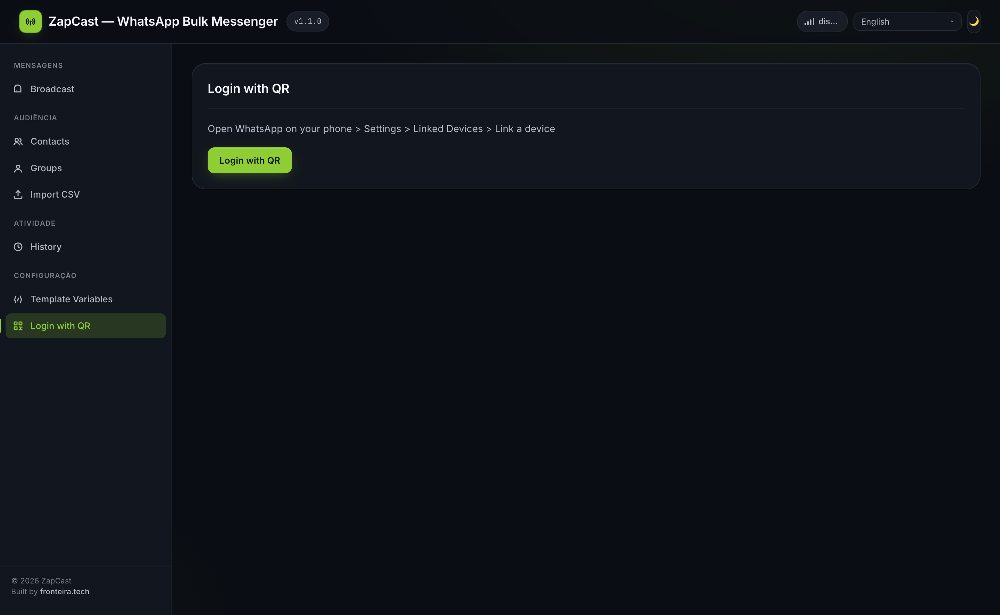
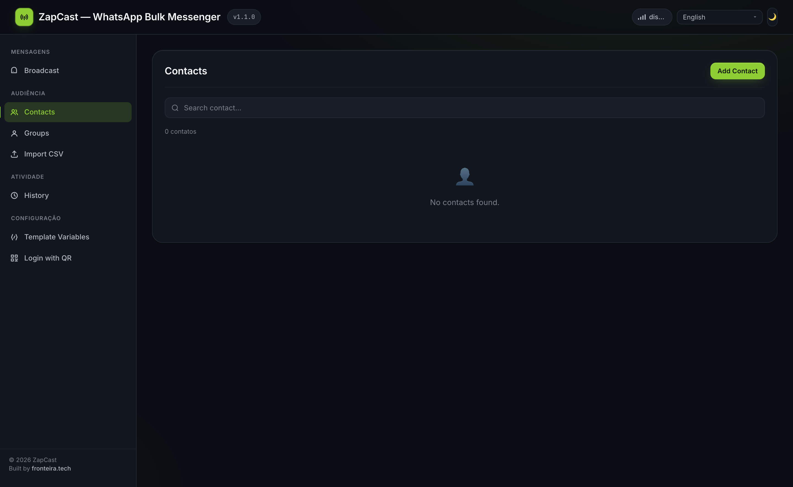

# ZapCast

[](docs/LICENSE)
[](https://go.dev/)
[](https://github.com/tulir/whatsmeow)
[](#docker)

**ZapCast** is a self-hosted web app for WhatsApp bulk messaging. It manages contacts, groups and message templates, then sends personalised broadcasts through `whatsmeow`, an unofficial Go client for the WhatsApp Multi-Device protocol.

> **Disclaimer.** ZapCast is not affiliated with, endorsed by, or sponsored by WhatsApp or Meta Platforms, Inc. It uses an unofficial reverse-engineered protocol implementation. Using it may violate WhatsApp's Terms of Service and can result in your number being banned. You are solely responsible for how you use it. Do not use it for spam.

## Screenshots

| Broadcast composer | Linked-device login | Contacts list |
|--------------------|---------------------|---------------|
|  |  |  |

## Features

- WhatsApp authentication via QR Code using `whatsmeow` Multi-Device.
- Contact, group and template-variable management.
- CSV import for ZapCast, Google Contacts and Outlook-style exports with PT/EN headers.
- CSV export with spreadsheet-formula escaping.
- Message templates with `{name}` / `{nome}`, `{phone}` / `{telefone}` and custom variables.
- Broadcasts to a group or an ad-hoc contact selection.
- Persistent broadcast history, per-recipient status and WhatsApp receipt updates.
- Outbox retry/dead-letter support for transient delivery failures.
- Server-Sent Events for connection state, broadcast progress and receipts.
- Embedded SPA: raw files in development builds, Vite `web/dist` bundle in `-tags prod` builds.
- Optional `AUTH_TOKEN` protection, cookie-based browser sessions and CORS origin controls.
- Structured logs, runtime metrics, health/readiness probes and Docker support.

## Quickstart

### Prerequisites

- Go 1.26+
- C toolchain for cgo (`gcc`, `build-base`, or equivalent), required by `mattn/go-sqlite3`

### Run from source

```bash
git clone https://github.com/tassiods/zapcast.git
cd zapcast
go mod download
go run .
```

The dev build embeds `internal/server/web/` directly. The server listens on `http://127.0.0.1:3000` by default. Open it in a browser and scan the QR Code with WhatsApp mobile (**Settings → Linked Devices → Link a device**).

### Build a local binary

```bash
go build -trimpath -ldflags="-s -w" -o zapcast .
./zapcast
```

### Build a production-style binary

Production builds embed the Vite bundle instead of the raw web source and tests:

```bash
npm ci
npm run build
go build -trimpath -tags prod -ldflags="-s -w" -o zapcast .
```

## Configuration

All configuration is via environment variables.

| Variable | Default | Description |
|---|---:|---|
| `HOST` | `127.0.0.1` | Listen address. Binding beyond loopback without auth logs a warning. |
| `PORT` | `3000` | HTTP port. |
| `STORE_DIR` | `store` | SQLite/session directory, created with owner-only permissions. |
| `LOG_LEVEL` | `info` | `debug`, `info`, `warn` or `error`. |
| `LOG_FORMAT` | `text` | `text` or `json`. |
| `AUTH_TOKEN` | empty | Enables auth for `/api/*` and `/debug/vars`. Browsers exchange it for an HttpOnly session cookie; CLI clients may use `Authorization: Bearer ...`. |
| `FRONTEND_ORIGIN` | empty | Exact browser origin allowed for CORS/SSE when serving through another origin. |
| `BROADCAST_DELAY_MS` | `500` | Per-message delay, clamped to 100–30000 ms. |
| `BROADCAST_DELAY_JITTER` | `0.3` | ±fraction of delay, 0–0.9. |
| `BROADCAST_HOURLY_CAP` | `0` | Optional rolling hourly cap; `0` disables it. |

> When `AUTH_TOKEN` is unset, the API is open to callers that can reach the listener. Keep the default loopback bind, or put ZapCast behind TLS and an authenticated reverse proxy.

## Operational endpoints

- `GET /healthz` — process liveness.
- `GET /readyz` — database/client readiness.
- `GET /debug/vars` — `expvar` metrics, gated by auth when `AUTH_TOKEN` is set.

## Docker

```bash
docker build -t zapcast .
docker run -d \
  --name zapcast \
  -p 127.0.0.1:3000:3000 \
  -v zapcast_store:/app/store \
  zapcast
```

Or with Compose:

```bash
docker compose up -d
docker compose logs -f
```

The Compose file binds the host port to `127.0.0.1` by default. Set `ZAPCAST_BIND=0.0.0.0` only when you also configure `AUTH_TOKEN` or a protected reverse proxy.

## REST API

| Method | Route | Description |
|---|---|---|
| `GET` | `/api/auth/required` | Whether native auth is required. |
| `POST` | `/api/auth/login` | Exchange `AUTH_TOKEN` for an HttpOnly session cookie. |
| `POST` | `/api/auth/session/logout` | Revoke the browser session cookie. |
| `GET` | `/api/status` | WhatsApp connection state and app version. |
| `POST` | `/api/auth/qr` | Start QR Code login stream. |
| `POST` | `/api/auth/logout` | Disconnect from WhatsApp. |
| `GET` | `/api/contacts` | List contacts; supports `?q=`, `?page=` and `?limit=`. |
| `POST` | `/api/contacts` | Create a contact. |
| `PUT` | `/api/contacts/{phone}` | Update a contact. |
| `DELETE` | `/api/contacts/{phone}` | Remove a contact. |
| `GET` | `/api/contacts/export` | Export contacts as CSV. |
| `GET` | `/api/groups` | List groups; supports optional paging. |
| `POST` | `/api/groups` | Create a group. |
| `PUT` | `/api/groups/{name}` | Update a group. |
| `DELETE` | `/api/groups/{name}` | Remove a group. |
| `GET` | `/api/templates` | List custom template variables. |
| `POST` | `/api/templates` | Create/update a template variable. |
| `DELETE` | `/api/templates/{key}` | Remove a template variable. |
| `POST` | `/api/import` | Import contacts from multipart CSV. |
| `POST` | `/api/broadcast` | Enqueue a broadcast. |
| `POST` | `/api/broadcast/cancel` | Cancel an in-flight broadcast. |
| `GET` | `/api/broadcasts` | Broadcast history. |
| `GET` | `/api/broadcasts/{id}` | Per-message detail for a broadcast. |
| `GET` | `/api/stats` | Aggregate delivery stats. |
| `GET` | `/api/events` | SSE stream. |
| `GET` | `/api/translations` | Localised UI strings with ETag support. |
| `POST` | `/api/client-error` | Client-side error telemetry sink. |
| `GET` | `/api/outbox/dead` | Dead-letter rows that exhausted retries. |

Pagination on `/api/contacts` and `/api/groups` is opt-in. Without `page`/`limit`, responses remain full arrays; with both parameters, responses use `{items, total, page, limit}`.

## CSV import

Accepted columns include `Name`/`Nome`, `Phone`/`Telefone` and optional `Group`/`Grupo`. Google Contacts and Outlook exports are auto-detected.

```csv
Name,Phone,Group
John Doe,15551234567,Customers
Jane Smith,15557654321,Suppliers
```

Phones are normalised and validated as E.164-style digits: 7–15 digits, no leading `0`.

## Message templates

Broadcast bodies can use:

- `{name}` / `{nome}`
- `{phone}` / `{telefone}`
- Any custom variable stored through `/api/templates`

Example:

```text
Hi {name}! Your reference is {order_id}.
```

## Architecture

```text
zapcast/
├── main.go                    # thin entry point; calls server.Run()
├── cmd/seed/                  # fake data seeder for UX testing
├── internal/server/           # HTTP app, storage, WhatsApp integration and web assets
│   ├── server.go              # App, lifecycle, route registration
│   ├── contacts.go            # ContactStore and persistence APIs
│   ├── migrations/            # versioned SQLite migrations
│   ├── broadcast.go           # broadcast handler
│   ├── broadcaster.go         # in-flight broadcast lifecycle
│   ├── outbox.go              # retry/dead-letter worker
│   ├── sse.go + sse_events.go # SSE hub and typed payloads
│   └── web/                   # SPA source; dist/ is generated by Vite
├── e2e/                       # Playwright browser smoke tests
├── Dockerfile
├── docker-compose.yml
└── store/                     # runtime data, gitignored
```

More details are in [docs/ARCHITECTURE.md](docs/ARCHITECTURE.md) and agent-specific notes are in [AGENTS.md](AGENTS.md).

## Tests

```bash
npm ci
npm test
npm run test:types
npm run build
npm run test:e2e

go test ./...
go test -race -coverprofile=coverage.out ./...
```

`e2e/` contains Playwright end-to-end smoke tests. They launch the web app and validate real browser behaviour that unit tests do not cover.

## Security

See [SECURITY.md](SECURITY.md) for supported versions, disclosure process and the stable API error envelope. Public exposure should use TLS, `AUTH_TOKEN`, a high-entropy token and a pinned `FRONTEND_ORIGIN`.

## Roadmap

- Webhook outputs to external systems.
- Scheduled broadcasts.
- Multi-account / multi-device support.
- Export of broadcast history.
- Worker-pool or external-queue delivery backend for higher throughput.

## Contributing

Issues and pull requests are welcome. Read [CONTRIBUTING.md](docs/CONTRIBUTING.md), [CODE_OF_CONDUCT.md](docs/CODE_OF_CONDUCT.md) and [AGENTS.md](AGENTS.md) before making larger changes.

## License & attribution

ZapCast is licensed under the Apache License 2.0. See [docs/LICENSE](docs/LICENSE) and [docs/NOTICE](docs/NOTICE).

```text
Copyright 2025 ZapCast contributors
Licensed under the Apache License, Version 2.0.
```

Redistributions and derivative works must retain the [NOTICE](docs/NOTICE) file and preserve required attribution.

ZapCast depends on [whatsmeow](https://github.com/tulir/whatsmeow), distributed under MPL-2.0. WhatsApp is a trademark of Meta Platforms, Inc.; ZapCast is not affiliated with, endorsed by, or sponsored by WhatsApp or Meta.
